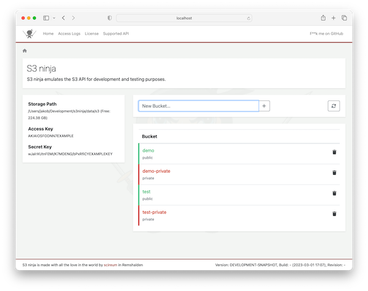

S3 ninja
========

S3 ninja emulates the Amazon S3 API for development and test purposes.



## Usage

A readily packaged Docker image is available on Docker Hub: [scireum/s3-ninja](https://hub.docker.com/r/scireum/s3-ninja/)
(`linux/amd64` and `linux/arm64`).

1. Run it like `docker run -p 9444:9000 scireum/s3-ninja:latest`.
2. Navigate to http://localhost:9444/ui to manage buckets and to look up the access key and secret key.
3. Run S3 API calls against http://localhost:9444/ (e.g. http://localhost:9444/test-bucket/test-object). If your
   application generates URLs like http://test-bucket.localhost:9444/test-object, you will need to configure your S3
   client to use path-style endpoints.

Provide a volume for `/home/sirius/data` to persist data across restarts. S3 ninja runs as user id 2000 inside the
container, so change the owner (user and group id) of an existing directory you link into the container to 2000.

For private buckets, the `Authorization` header of a request is verified using the credentials shown in the UI. ACLs
are ignored, except for `x-amz-acl: public-read-write` when creating a bucket, which makes it public.

## How strict is S3 ninja?

S3 ninja aims to refuse what S3 refuses, so that mistakes of a client surface during development:

- Signed requests are verified: the signature, the access key, the expiry of presigned URLs and the time of signing.
  Requests without any signature are accepted for public buckets only.
- Uploads are verified against `Content-MD5`, `x-amz-content-sha256` and the `x-amz-checksum-*` headers for CRC32,
  CRC32C, SHA-1 and SHA-256. Checksums sent as trailer of a streamed upload and CRC64NVME are not verified.
- `If-Match`, `If-None-Match`, `If-Modified-Since` and `If-Unmodified-Since` are honoured when reading an object,
  and for the source when copying one. Writing honours `If-Match` and `If-None-Match`, and of several requests
  which create the same object with `If-None-Match: *`, exactly one succeeds.
- Browser-based uploads are only served if the signature of their policy is correct, the policy has not expired
  and its conditions are met.
- Creating a bucket which exists already answers `BucketAlreadyOwnedByYou`, unless the request is signed for the
  region `us-east-1`. As for S3, it then succeeds and resets the access control list of the bucket.
- Objects are listed in the binary order of their UTF-8 keys, with `delimiter`, `prefix`, `marker`, `start-after`
  and continuation tokens, and at most 1000 entries per request.

Known limits: object keys can be up to 243 bytes long once URL encoded, as objects are kept as files. Versioning,
tagging, object lock, encryption and stored ACL, CORS, policy or lifecycle documents are not provided; requests for
them answer `NotImplemented` or a fixed document. Storing an ACL or a CORS configuration is accepted without effect,
so that scripts which set up a bucket keep working.

## Multipart uploads

Multipart uploads follow the rules of S3, so that mistakes of a client surface here and not only against a real S3:

- Completing an upload verifies the `ETag` of every part (`InvalidPart`), their ascending order (`InvalidPartOrder`)
  and the minimum size of every part except the last one (`EntityTooSmall`). A rejected request leaves the upload open.
- Part numbers must be integers from 1 to 10000 (`InvalidArgument`).
- The `ETag` of the final object is the MD5 hash of the MD5 hashes of its parts, followed by `-` and the number of parts.
- Upload IDs are random. `ListParts`, `ListMultipartUploads`, `UploadPartCopy` and `AbortMultipartUpload` are supported.

The minimum part size is 5 MiB as in S3. Sending parts of that size can slow down the tests of a client, so the limit
can be lowered with the setting `storage.multipartMinPartSize`, e.g. by passing
`-e storage.multipartMinPartSize=1024` to `docker run`. Clients which cut their parts too small will then go unnoticed.

Open uploads are kept in `/home/sirius/multipart` and survive a restart of the container. Provide a volume for that
directory as well if they have to survive the container being re-created.

As in S3, an upload is kept until it is completed or aborted, so uploads which a client abandoned pile up. On an
instance which runs for a long time, `storage.multipartAbortAfter`, e.g. `-e "storage.multipartAbortAfter=7 days"`,
aborts uploads that long after their initiation.

## Development with Docker

### Quick Start with Docker Compose
To run S3 Ninja using Docker Compose for development:

1. Ensure you have Docker and Docker Compose installed.
2. From the project root, run:
   ```
   docker-compose up --build
   ```
   This will build the image and start the service on port 9444, with data persisted in the `./data` directory.

### Manual Docker Commands
- Build the image (requires Maven artifacts in `target/`):
  ```
  docker build -t s3ninja:local .
  ```
- Run the container:
  ```
  docker run --rm -p 9444:9000 -v "$PWD/data:/home/sirius/data" s3ninja:local
  ```
  - Access the UI at: http://localhost:9444/ui
  - S3 API endpoint: http://localhost:9444/

### Development Workflow
- Mount your local `data/` directory to persist buckets and objects across container restarts.
- For code changes, rebuild the image after running `mvn clean package -DskipTests`.

## Using S3 Presigned POST URLs

S3 Ninja supports AWS S3-compatible presigned POST requests for secure file uploads.

### Generate via UI (docker-friendly)

1. Launch the web UI (default: `http://localhost:9444/ui`) and click **Presigned POST Workbench** or go directly to `http://localhost:9444/ui/presigned-post`.
2. Fill bucket/key/region plus optional session token (generate it inline) and hit **Generate Presigned POST**.
3. Copy the auto-generated HTML form or use the embedded **Test Upload** panel to POST a file against your running instance, no Maven needed.
4. Inspect the policy JSON, Base64 policy, and signature in the results card for debugging or automation.

### Making the Request
- **URL**: `POST http://localhost:9444/<bucket>`, as for S3. The key is sent as form field.
- **Content-Type**: `multipart/form-data`
- **Form Fields**: Include the generated fields plus the file to upload as `file=@/path/to/file`, which has to be the
  last field.

Example `curl` command:
```
curl -X POST "http://localhost:9444/test" \
  -F "key=example.txt" \
  -F "policy=<BASE64_POLICY>" \
  -F "x-amz-algorithm=AWS4-HMAC-SHA256" \
  -F "x-amz-credential=<ACCESS_KEY>/<DATE>/<REGION>/s3/aws4_request" \
  -F "x-amz-date=<YYYYMMDDTHHMMSSZ>" \
  -F "x-amz-signature=<HEX_SIGNATURE>" \
  -F "file=@example.txt"
```

If using a session token (from `/session-token` endpoint), add:
```
-F "x-amz-security-token=<SESSION_TOKEN>"
```

The policy enforces conditions like bucket, key, expiration, and optional security token. On success, the file is uploaded; on failure, an XML error is returned.

The policy and its signature are verified as S3 does: the signature has to cover the policy in its Base64 encoding,
exactly as it is sent in the `policy` field. This is what `generate_presigned_post` of boto3 and the other SDKs
produce. Both signature version 4 (`x-amz-signature`) and version 2 (`signature`) are accepted. An upload with a wrong
signature, an expired policy or a condition which is not met is refused, also if the bucket is public.

The workbench of the UI sends the generated fields as query string to `POST /<bucket>/<key>`, with the file as body
of the request. This is a convenience of S3 ninja which S3 does not offer.

## Contributions

Contributions as issues or pull requests are always welcome. Please [sign off](https://developercertificate.org) 
all your commits by adding a line like "Signed-off-by: Name <email>" at the end of each commit, indicating that
you wrote the code and have the right to pass it on as an open source

## License

S3 ninja is licensed under the MIT License:

> Permission is hereby granted, free of charge, to any person obtaining a copy
> of this software and associated documentation files (the "Software"), to deal
> in the Software without restriction, including without limitation the rights
> to use, copy, modify, merge, publish, distribute, sublicense, and/or sell
> copies of the Software, and to permit persons to whom the Software is
> furnished to do so, subject to the following conditions:
> 
> The above copyright notice and this permission notice shall be included in
> all copies or substantial portions of the Software.
> 
> THE SOFTWARE IS PROVIDED "AS IS", WITHOUT WARRANTY OF ANY KIND, EXPRESS OR
> IMPLIED, INCLUDING BUT NOT LIMITED TO THE WARRANTIES OF MERCHANTABILITY,
> FITNESS FOR A PARTICULAR PURPOSE AND NONINFRINGEMENT. IN NO EVENT SHALL THE
> AUTHORS OR COPYRIGHT HOLDERS BE LIABLE FOR ANY CLAIM, DAMAGES OR OTHER
> LIABILITY, WHETHER IN AN ACTION OF CONTRACT, TORT OR OTHERWISE, ARISING FROM,
> OUT OF OR IN CONNECTION WITH THE SOFTWARE OR THE USE OR OTHER DEALINGS IN
> THE SOFTWARE.
